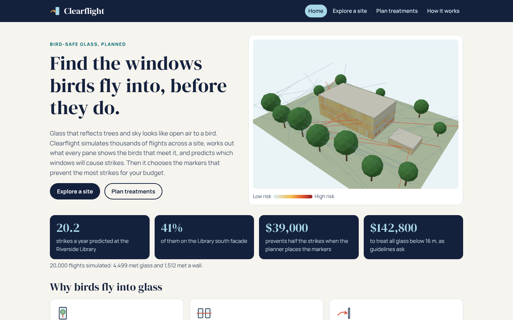
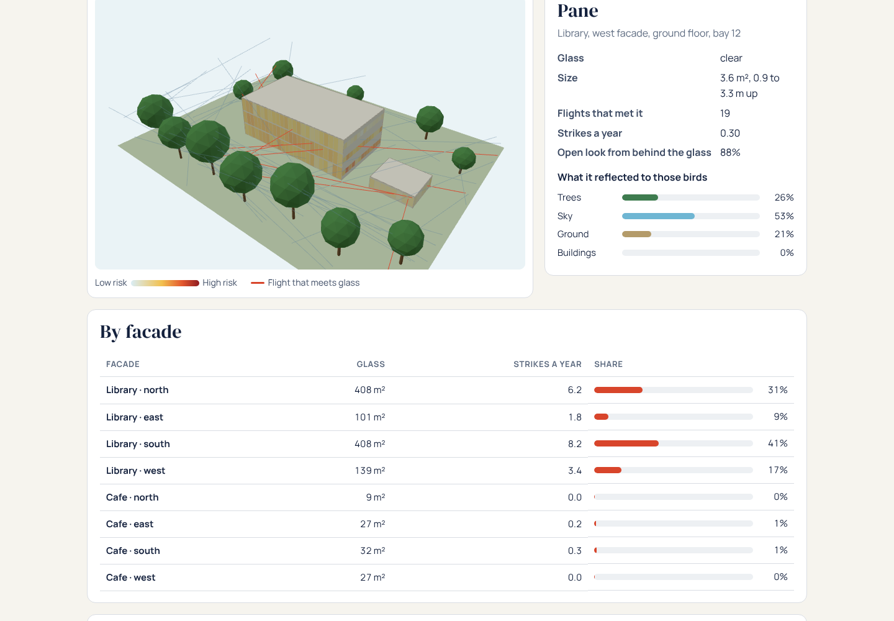
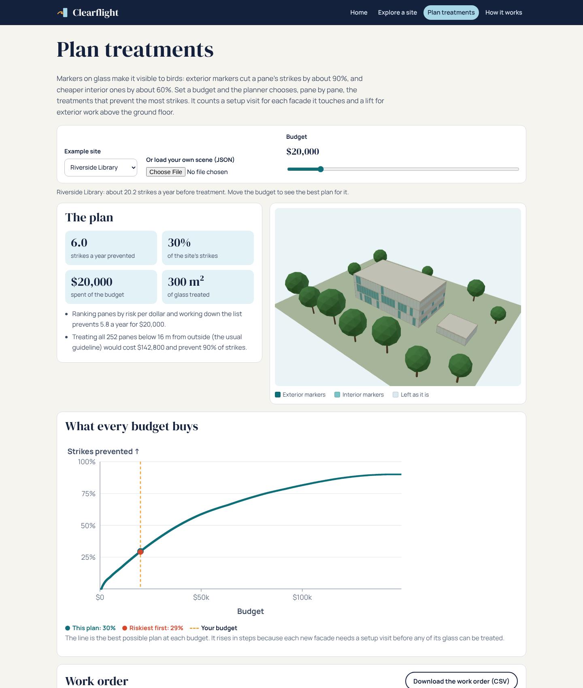
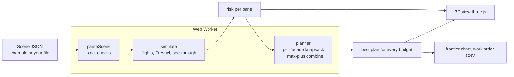

# Clearflight

**Find the windows birds fly into, before they do.** Clearflight simulates thousands of bird flights across a site and traces what every pane of glass reflects at the angle each bird meets it. That predicts which windows will cause strikes. Then an exact optimiser chooses the window markers that prevent the most strikes for your budget.

[](https://github.com/reihooneh/clearflight/actions/workflows/ci.yml)


**Live demo: [reihooneh.github.io/clearflight](https://reihooneh.github.io/clearflight/)** (runs entirely in your browser)



## Why I built this

Collisions with glass kill hundreds of millions of birds a year in the United States alone (Loss et al., 2014), and most of those strikes happen at low-rise buildings and homes, not skyscrapers. The fix is known: markers on the glass, spaced closely enough that birds see a barrier. Guidelines such as CSA A460 ask for all glass up to 16 m to be treated, which is expensive to do in one go for an existing building.

So a facilities manager with a limited budget faces a real question: **which glass first?** The existing tools are checklists and spreadsheets of "threat factors" per material. None of them looks at the site's geometry: which panes reflect the trees, which ones birds actually fly towards, where a glass lobby lets a bird see straight through to the trees beyond. Clearflight works that out, then treats the spending as the optimisation problem it is.

## What it does

- **Simulates flights.** Birds fly between tree crowns, low over open ground and across the site: 20,000 seeded flights per run. Each flight that reaches glass meets a pane.
- **Traces what the bird sees** at that pane:
  - the **reflection**, using the Fresnel effect, so glass reflects far more at a slant, and mirror glass a lot even head-on;
  - the **view through** the glass: a dark room, or, on a see-through floor, daylight and trees on the far side.
- **Predicts strikes per pane, per facade and per site.** In the 3D view every pane is coloured by risk. Click one to see what it reflected to the birds that met it.
- **Plans treatments exactly.** For each pane, the planner chooses nothing, interior markers (≈60% fewer strikes) or exterior markers (≈90% fewer). It charges a setup visit per facade it touches and a lift for exterior work above the ground floor. It finds the best plan for every budget at once, so the budget slider is instant.
- **Compares honestly:**
  - with the guideline approach (treat all glass under 16 m);
  - with "riskiest per dollar first", which the exact plan beats by 13–34% at a $5,000 budget on the example sites.
- **Hands over a work order** as a CSV.

At the example Riverside Library (≈20 strikes a year predicted), 41% of the strikes are on the south facade. **$39,000 of well-placed markers prevents half the strikes**, against $142,800 to treat all the glass below 16 m.

| Explore a site | Plan treatments |
|---|---|
|  |  |

## How it fits together



The engine (`src/engine`) is plain TypeScript with no dependencies. It runs in a Web Worker in the browser and in Node for the tests. The pages (`src/web`, `src/pages`) are compiled TypeScript with a self-hosted three.js and no framework.

## Stack

TypeScript (strict, `noUncheckedIndexedAccess`) · three.js (self-hosted) · Web Workers · SVG charts · node:test · Playwright · GitHub Actions and Pages. No runtime dependencies besides three.js.

## Run it locally

```bash
npm ci
npm run build          # tsc + page build into site/
npm run serve          # http://127.0.0.1:4173/
```

Your own site is a JSON file. Download an example from the Explore page and edit it:

```json
{
  "name": "My office",
  "width": 60, "depth": 50,
  "flightsPerDay": 500,
  "buildings": [
    { "name": "Office", "x": 20, "y": 15, "width": 24, "depth": 14, "floors": 4,
      "seeThrough": [1],
      "all": { "glazing": 0.6, "glass": "low-e" },
      "facades": { "south": { "glazing": 0.9, "glass": "clear" } } }
  ],
  "trees": [ { "x": 10, "y": 8, "height": 12, "crown": 4 } ]
}
```

Glass kinds are `clear`, `low-e`, `tinted` and `mirror`. Existing markers go in `"treated": "interior"` or `"exterior"`.

## Tests

```bash
npm test               # engine: 12 tests
npm run test:web       # browser: 19 tests at phone, tablet and desktop sizes
npm run check          # strict type check
```

- **Exactness:** the planner is checked against **every combination** of treatments (up to 3⁸ per building) on random small buildings, at budgets from $0 to $6,000.
- **Geometry and physics:** ray–box and ray–sphere geometry, every pane found again from its own centre, Fresnel limits, and the model's directions (mirror glass, see-through floors and reflected trees all raise the risk).
- **Hostile scene files:** invalid JSON, unknown keys, `__proto__`, `1e999`, HTML in names, direction-override characters, overlapping buildings, oversize scenes.
- **Browser tests:** every page at three sizes, failing on overlapping text (HTML and SVG), overlapping controls, SVG outside its chart, sideways scrolling and console errors. They also check the CSP, the WebGL-less fallback, hostile uploads, the budget slider, the CSV and the static server's path handling.

## Security

- **Your data stays with you:** everything runs in your browser. No accounts, no tracking, and scene files never leave your device.
- **Scene files are data, never code:**
  - they're parsed with `JSON.parse` and checked against a list of allowed keys (so `__proto__` is refused);
  - every number is checked for range;
  - names are checked against a fixed set of characters;
  - there are limits on size and count (256 KB, 12 buildings, 8,000 panes, 100,000 flights, a $200,000 budget).
- **Safe pages:** all text is added as text (a test fails if the built code uses `innerHTML`, `eval` or `new Function`). A strict Content-Security-Policy with no inline code is in place, everything is self-hosted, and the CSV export is protected against formula injection.
- **Responsive:** the engine runs in a Web Worker, so a heavy scene can't freeze the page.
- **Supply chain and CI:** dependencies are pinned and audited in CI, and CI checks that the published site matches its sources.

See [SECURITY.md](SECURITY.md) for the threat model.

**Known limits:**
- Strikes a year are a model estimate, calibrated to the ranges field studies report. The ranking of panes and the comparison of plans are its strengths.
- Night-time strikes from lit windows aren't modelled yet.
- Buildings are boxes with ribbon windows.

## Roadmap

- Night mode: lights left on during migration attract birds to lit floors.
- Species groups: low-flying ground foragers compared with canopy birds, with their own flight heights.
- Seasons: leaf-off trees reflect differently in winter.
- Draw a site on a map instead of writing JSON.

## Learn how it works

[HOW-IT-WORKS.md](HOW-IT-WORKS.md) walks through the model, the planner and the trade-offs, with interview questions.

MIT licensed.
